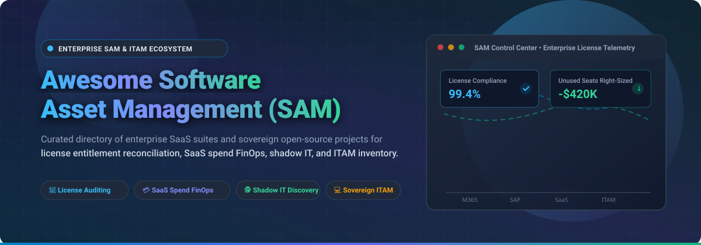

# 🚀 Awesome Software Asset Management (SAM) Ecosystem

<p align="center">
  
</p>

<p align="center">
  <a href="https://github.com/ishandutta2007/Awesome-Awesome-Awesome"></a><a href="https://discord.gg/jc4xtF58Ve"></a>
  <a href="https://github.com/ishandutta2007/Awesome-Software-Asset-Management-Sam/stargazers"></a>
  <a href="https://github.com/ishandutta2007/Awesome-Software-Asset-Management-Sam/network/members"></a>
  <a href="https://github.com/ishandutta2007/Awesome-Software-Asset-Management-Sam/blob/main/LICENSE"></a>
  <a href="https://github.com/ishandutta2007/Awesome-Software-Asset-Management-Sam/pulls"></a>
  <a href="https://github.com/ishandutta2007"></a>
</p>

---

> **A curated directory of top Software Asset Management (SAM), SaaS Management Platforms (SMP), and IT Asset Management (ITAM) enterprise suites alongside sovereign open-source license compliance engines, CMDB inventory trackers, and SBOM analyzers.**

*Focused on Software License Entitlement Reconciliation, SaaS Spend Optimization (FinOps), Shadow IT Discovery, Tier-1 Publisher Audit Defense (Microsoft, SAP, Oracle, IBM), and IT Asset Governance.*

---

## 📑 Table of Contents

- [📊 Sector Overview & Market Dynamics](#-sector-overview--market-dynamics)
- [🏢 SaaS & Hosted Enterprise SAM Platforms](#-saas--hosted-enterprise-sam-platforms)
- [💻 Open-Source GitHub Projects (Ranked by Stars)](#-open-source-github-projects-ranked-by-stars)
- [🔬 SAM Core Architecture & Lifecycle Pipeline](#-sam-core-architecture--lifecycle-pipeline)
- [🔍 SEO & Industry Keywords](#-seo--industry-keywords)
- [🤝 How to Contribute](#-how-to-contribute)
- [💖 Support & Community](#-support--community)
- [##  Star History](#--star-history)
- [⚠️ Compliance & Disclaimer](#-compliance--disclaimer)

---

## 📊 Sector Overview & Market Dynamics

The global **Software Asset Management (SAM)** and **SaaS Management Platform (SMP)** market is estimated at approximately **$3.8 Billion to $4.5 Billion in 2025–2026** and is projected to expand to **$8.6 Billion to $10.2 Billion by 2032**, registering a robust Compound Annual Growth Rate (**CAGR of ~14.8%**). Growth is propelled by enterprise SaaS proliferation, unmanaged shadow IT subscriptions, aggressive publisher license audits (Oracle, Microsoft, SAP, IBM), and the convergence of ITAM with cloud **FinOps**.

The industry demonstrates a **moderately concentrated structure at the enterprise core**, where multi-billion-dollar vendors (*SAP/LeanIX, ServiceNow, Flexera/Snow, and Ivanti*) dominate complex datacenter software inventory, sub-capacity virtualization licensing, and tier-1 vendor reconciliation. Conversely, the market experiences **rapid fragmentation across SaaS spend management and edge IT discovery**, where agile platforms (*Zylo, Torii, Productiv, Lansweeper*) compete aggressively to uncover shadow cloud tools and AI agent subscriptions, while sovereign, self-hosted open-source solutions (*Snipe-IT, InvenTree, GLPI*) provide independent organizations with telemetry ownership free from recurring per-asset license taxes.

---

## 🏢 SaaS & Hosted Enterprise SAM Platforms

*The following table catalogs category-defining commercial Software Asset Management and SaaS Management platforms. Sorted descending by company size (valuation / market capitalization).*

| 🏢 Platform / Vendor | 💰 Company Valuation / Revenue | 🏷️ Specific Starting Pricing | 🎁 Specific Free Tier / Trial Limits | ⚡ Core SAM & ITAM Capabilities |
| :--- | :--- | :--- | :--- | :--- |
| **[LeanIX (SAP LeanIX)](https://www.leanix.com/)** | **~$260 Billion Market Cap** (NYSE: `SAP`; €33B+ Annual Revenue; acquired for ~$1.3B) | **$25,000 / year** (Base package covering up to 500 managed applications and unlimited view-only stakeholders) | **14-Day Free Trial** with access to sample enterprise architecture workspace, SaaS discovery connectors, and up to 50 application fact sheets | Enterprise architecture & software asset portfolio mapping, automated SaaS discovery, technology risk & obsolescence tracking, and lifecycle roadmapping. |
| **[ServiceNow Software Asset Management](https://www.servicenow.com/)** | **~$190 Billion Market Cap** (NYSE: `NOW`; ~$11.0B ARR) | **$100 / user / year** (SAM Pro add-on) or bundled in ITSM Enterprise at **$160 / user / month** (Annual enterprise baseline starts at ~$30,000 / year) | **Indefinite Free Personal Developer Instance (PDI)** with full admin features and SAM developer plugins (active indefinitely if accessed every 10 days) or 15-day guided enterprise sandbox | Publisher Compliance Summarization via Now Assist, automated license reconciliation (Microsoft 365, Oracle, SAP, IBM), SAP Ariba subscription sync, and low-usage seat reclamation. |
| **[Ivanti Neurons for SAM](https://www.ivanti.com/)** | **~$4.0 Billion Valuation** (Clearlake Capital & Charlesbank; ~$1.5B Annual Revenue) | **$3.50 / device / month** (Billed annually at $42 / device / year; entry commercial minimum package ~$12,500 / year for ~300 devices) | **45-Day Free Trial** of Ivanti Neurons cloud platform with discovery agent access for up to 100 endpoints and complete software usage telemetry | Unified endpoint discovery (active, passive, third-party connectors), software normalization engine, license position calculation, and procurement-to-retirement lifecycle workflows. |
| **[Flexera One](https://www.flexera.com/)** | **~$3.5 Billion Valuation** (Thoma Bravo & TA Associates; ~$500M+ Annual Revenue) | **$32,000 / year** (Base enterprise subscription covering up to 1,000 monitored hybrid server/cloud instances and desktop endpoints) | **30-Day Sales-Assisted Proof of Value (PoV) Sandbox** with SKU Browser access for up to 250 sample asset discoveries | Hybrid ITAM and FinOps synergy, IBM-certified and Oracle-verified license data, SKU Catalog with 5M+ software titles, Kubernetes/OpenShift discovery, and SaaS Publisher Hub. |
| **[Snow Software](https://www.snowsoftware.com/)** | **~$1.0 Billion Valuation** (Merged under Flexera / Thoma Bravo; ~$150M+ ARR) | **$18,000 / year** (Snow License Manager entry deployment covering up to 500 client devices or servers) | **30-Day Guided Proof of Concept (PoC)** with Snow Inventory Agent deployed on up to 50 test nodes with audit risk reporting | Snow License Manager (SLM) on-prem and cloud entitlement engine, automated license right-sizing, audit defense reporting, and multi-cloud IaaS/SaaS spend tracking. |
| **[Lansweeper](https://www.lansweeper.com/)** | **~$1.0 Billion Valuation** (Insight Partners backed; ~$100M ARR) | **$2.19 / asset / month** (Starter plan billed annually at $2,628 / year for 100 assets) or Pro tier at **$3.49 / asset / month** | **Free-Forever Tier for up to 100 assets** with unlimited IP network scanning, software inventory, and NIST vulnerability insights (or 14-day unlimited enterprise trial) | Agentless network discovery across IT, OT, and IoT, automated software installation detection, software license compliance audits, and bidirectional CMDB integration. |
| **[Zylo](https://zylo.com/)** | **~$400 Million Valuation** (Series C backed by Bessemer, Coupa; ~$35M ARR) | **$25,000 / year** (Core edition covering up to $1M in annual SaaS spend and up to 250 employees) | **14-Day Guided SaaS Discovery Assessment** ingesting corporate credit card/AP expense data for up to 100 SaaS apps to identify immediate shadow IT | AI Smart Filters (natural language reporting), Contract Assist Agent for PDF order form ingestion, real-time license usage tracking via 300+ integrations, and renewal benchmark workflows. |
| **[Productiv](https://productiv.com/)** | **~$350 Million Valuation** (Series C backed by Accel, Norwest, IVP; ~$30M ARR) | **$18,000 / year** (Essentials tier for organizations with up to 500 employee seats and 50 monitored cloud apps) | **30-Day Free SaaS Health Check** with read-only Okta/Google Workspace SSO connector tracking up to 50 cloud apps and active seat engagement metrics | SaaS Intelligence platform, feature-level license usage tracking (e.g., Zoom, Salesforce, Figma), App Procurement Hub, and contract renewal optimization. |
| **[Torii](https://www.toriihq.com/)** | **~$250 Million Valuation** (Series B backed by Tiger Global, Wing VC; ~$25M ARR) | **$12,000 / year** (Essentials plan for organizations with up to 300 employees and unlimited cloud integrations) | **14-Day Full-Access Free Trial** with automated discovery across Google Workspace/Microsoft 365, browser extension, and up to 20 native connectors | Gartner Magic Quadrant Leader for SMP, continuous shadow IT discovery, automated user onboarding/offboarding workflows, license right-sizing, and AI tool spend governance. |
| **[USU Software Asset Management](https://www.usu.com/)** | **~$150 Million Market Cap** (Frankfurt: `OSP2` / Thoma Bravo; ~$145M Revenue) | **€14,000 (~$15,000) / year** (Entry package for Data Center & Client SAM covering up to 1,000 nodes) | **30-Day Virtual Lab Sandbox Trial** with sample SAP, Microsoft, and Oracle license entitlement models and 90%+ automated product recognition | Deep SAP licensing optimization (S/4HANA migration modeling), Oracle database core licensing calculations, cloud subscription right-sizing, and audit defense. |

---

## 💻 Open-Source GitHub Projects (Ranked by Stars)

*For IT administrators, sovereign infrastructure teams, and DevOps engineers seeking transparent, self-hosted software asset tracking, license compliance auditing, and CMDB inventory tools without per-seat licensing lock-in. Sorted descending by GitHub stargazers count.*

1. **[snipe/snipe-it](https://github.com/snipe/snipe-it)** [](https://github.com/snipe/snipe-it/stargazers)  
   *Technology: PHP / Laravel / Docker / MySQL*  
   The world's leading open-source IT asset and software license management system (~15,000+ GitHub stars). Empowers organizations to track software seats, associate software licenses with specific users and physical hardware, manage license checkouts and expirations, calculate asset depreciation, and enforce LDAP/SAML access with an extensive REST API.

2. **[inventree/InvenTree](https://github.com/inventree/InvenTree)** [](https://github.com/inventree/InvenTree/stargazers)  
   *Technology: Python / Django / React / Docker*  
   Modern, extensible open-source inventory and asset management system (~7,700+ GitHub stars). Provides enterprise-grade stock tracking, item categorization, barcode/QR code generation, configurable lifecycle states, and a RESTful API suitable for organizing physical assets, component serials, and equipment assignments.

3. **[glpi-project/glpi](https://github.com/glpi-project/glpi)** [](https://github.com/glpi-project/glpi/stargazers)  
   *Technology: PHP / MariaDB / ITIL*  
   Free IT asset and service management software package (~6,500+ GitHub stars). Includes comprehensive software license tracking, financial tracking, ITIL-aligned service desk, and deep CMDB functionality. Integrates with the GLPI native inventory agent for automated cross-platform software discovery and auditing.

4. **[Shelf-nu/shelf.nu](https://github.com/Shelf-nu/shelf.nu)** [](https://github.com/Shelf-nu/shelf.nu/stargazers)  
   *Technology: TypeScript / Node.js / Next.js / Supabase*  
   Modern open-source asset management infrastructure (~3,000+ GitHub stars) created as a collaborative, self-hosted alternative to spreadsheets. Features instant QR/barcode asset tagging, custody history logging, check-in/check-out workflows, and a minimalist web UI.

5. **[nexB/scancode-toolkit](https://github.com/nexB/scancode-toolkit)** [](https://github.com/nexB/scancode-toolkit/stargazers)  
   *Technology: Python*  
   Comprehensive open-source software license scanner and SBOM generator (~2,650+ GitHub stars). Scans application codebases and container images to detect commercial, open-source, and copyleft licenses, copyright notices, and dependency manifests—critical for software license compliance and legal due diligence.

6. **[allegro/ralph](https://github.com/allegro/ralph)** [](https://github.com/allegro/ralph/stargazers)  
   *Technology: Python / Django / MySQL*  
   Full-featured open-source CMDB and IT Asset Management platform for datacenter and back-office infrastructure (~2,530+ GitHub stars). Built by Allegro to manage software licenses, server racks, virtualization clusters, domain ownership, and hardware lifecycles.

7. **[Combodo/iTop](https://github.com/Combodo/iTop)** [](https://github.com/Combodo/iTop/stargazers)  
   *Technology: PHP / MySQL*  
   Web-based open-source CMDB and IT Service Management solution (~1,200+ GitHub stars). Links software installations, user entitlements, service delivery contracts, and physical servers within a relational configuration management database.

8. **[fossology/fossology](https://github.com/fossology/fossology)** [](https://github.com/fossology/fossology/stargazers)  
   *Technology: C / PHP / PostgreSQL*  
   Open-source license compliance system and governance toolkit hosted under the Linux Foundation (~1,040+ GitHub stars). Runs automated license, copyright, and export control scans against software archives to generate audit-ready compliance reports and SPDX manifests.

9. **[itflow-org/itflow](https://github.com/itflow-org/itflow)** [](https://github.com/itflow-org/itflow/stargazers)  
   *Technology: PHP / MariaDB*  
   All-in-one open-source IT asset, license, and service management platform designed for internal IT teams and Managed Service Providers (MSPs) (~1,035+ GitHub stars). Features software license tracking, SSL/domain expiration alerts, vendor contract renewals, and client credential governance.

10. **[tern-tools/tern](https://github.com/tern-tools/tern)** [](https://github.com/tern-tools/tern/stargazers)  
    *Technology: Python*  
    Container software composition analysis and license inspection engine (~1,030+ GitHub stars). Inspects container layer filesystems to discover installed packages, compile licenses, and generate Software Bill of Materials (SBOM) for compliance audits.

11. **[OCSInventory-NG/OCSInventory-Server](https://github.com/OCSInventory-NG/OCSInventory-Server)** [](https://github.com/OCSInventory-NG/OCSInventory-Server/stargazers)  
    *Technology: Perl / C / PHP*  
    Mature, automated IT asset discovery and software inventory management server (~400+ GitHub stars). Collects detailed hardware and software configurations via cross-platform endpoint agents and synchronizes inventory data into external CMDBs.

12. **[devcode-it/openstamanager](https://github.com/devcode-it/openstamanager)** [](https://github.com/devcode-it/openstamanager/stargazers)  
    *Technology: PHP / JavaScript / MySQL*  
    Modular open-source ERP and service management software (~150+ GitHub stars) that includes asset tracking and client software license registration tailored for technical assistance teams and IT service providers.

---

## 🔬 SAM Core Architecture & Lifecycle Pipeline

When establishing an enterprise Software Asset Management or SaaS governance framework, organizations typically execute a four-stage continuous operational pipeline:

```
[1. Discovery & Telemetry]      [2. Normalization & Catalog]     [3. Entitlement Reconciliation]     [4. Optimization & Reclamation]
  • Active Network Scanners       • Title Standardizing (SKU)      • Contract Entitlement Baseline     • Unassigned License Harvesting
  • SSO & OAuth Integrations      • Publisher Version Mapping      • Effective License Position (ELP)  • Redundant SaaS Consolidation
  • Endpoint Agents (OS/Apps)     • Product Categorization         • Virtualization Core Rules (PVU)   • Automated Offboarding Flows
          ||                               ||                                ||                                  ||
          \/                               \/                                \/                                  \/
  Raw Inventory Datasets          Clean Software Catalog          Compliance & Audit Defense          Maximized Software ROI
```

1. **Discovery & Telemetry**: Continuous endpoint scanning (Lansweeper, GLPI Agent, OCS Inventory) coupled with SaaS API connectors and IdP (Okta, Entra ID, Google Workspace) ingestion to reveal managed applications and shadow IT subscriptions.
2. **Catalog Normalization**: Mapping divergent process names, package hashes, and version numbers into unified commercial software SKUs using curated recognition libraries.
3. **Entitlement Reconciliation**: Computing the **Effective License Position (ELP)** by matching active license keys and contract purchases against physical/virtual processor core metrics (IBM PVU, Oracle Processor Core Factor, Microsoft Core Licensing).
4. **Optimization & Automated Reclamation**: Revoking licenses from dormant or departed users, downgrading premium seats (e.g., Salesforce Enterprise to Standard, Zoom Pro to Basic), and renegotiating multi-year enterprise agreements with verified usage data.

---

## 🔍 SEO & Industry Keywords

`Software Asset Management (SAM)` • `IT Asset Management (ITAM)` • `SaaS Management Platform (SMP)` • `Effective License Position (ELP)` • `Software License Optimization` • `SaaS Spend FinOps` • `Shadow IT Discovery` • `Software Bill of Materials (SBOM)` • `License Entitlement Reconciliation` • `CMDB Software Inventory` • `Open Source ITAM` • `Snipe-IT License Tracking` • `GLPI Asset Management` • `Vendor Audit Defense (Microsoft, SAP, Oracle)` • `SaaS Contract Renewal Optimization`

---

## 🤝 How to Contribute

We welcome contributions from IT asset managers, FinOps engineers, procurement analysts, and open-source developers!

1. 🍴 **Fork the repository** on GitHub.
2. 🌿 **Create a feature branch**: `git checkout -b feature/add-new-sam-tool`.
3. 📝 **Add or update entries in `README.md`**: Follow the existing tabular structure for SaaS platforms (ensuring verified starting prices, specific trial terms, and company scale metrics) or open-source projects (including repo badge and stargazers link).
4. ✅ **Verify accuracy**: Ensure pricing figures and trial policies are cross-referenced with vendor websites or published rate sheets.
5. 🚀 **Submit a Pull Request** with a succinct description of your changes.

Explore more curated technical directories in the **[Awesome-Awesome-Awesome](https://github.com/ishandutta2007/Awesome-Awesome-Awesome)** index!

---

## 💖 Support & Community

Thank you for visiting and utilizing the **Awesome Software Asset Management (SAM)** repository! Maintaining this comprehensive ecosystem directory requires continuous research, license benchmarking, and ecosystem updates.

If this repository helped you evaluate SAM platforms, right-size software licenses, or structure your ITAM workflows:
- ⭐ **Star this repository** on GitHub to help other engineers, SAM analysts, and FinOps practitioners discover it!
- 🍴 **Fork and share** with your network, procurement teams, and IT asset communities.
- ☕ **Support & Buy a Coffee**: Sponsor ongoing research via the [GitHub Sponsor Dashboard](https://github.com/sponsors/ishandutta2007).

---

##  Star History
[](https://star-history.dera.page/#ishandutta2007/Awesome-Software-Asset-Management-Sam&type=date&legend=top-left)

---

## ⚠️ Compliance & Disclaimer

- **Community Curated**: This directory is an independent informational resource; listings do not represent commercial endorsement.
- **Contractual & Publisher Terms**: SAM platforms collecting software inventory and entitlement data must be operated in accordance with publisher licensing terms and confidentiality clauses; inaccurate reconciliation can expose organizations to vendor audit penalties.
- **Open-Source Scope**: Open-source ITAM solutions offer robust asset inventory and license assignment capabilities, but enterprise teams requiring vendor-certified rules for complex architectures (such as IBM PVU, SAP Digital Access, or Oracle Core Licensing) should complement open-source tools with certified compliance frameworks.
- **Licensing**: Verify the respective open-source licenses (GPL, AGPL, Apache 2.0, MIT) before deployment in corporate production environments.
